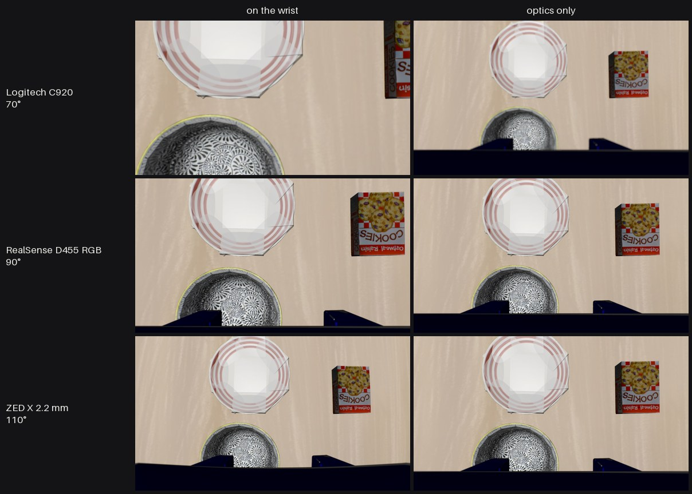
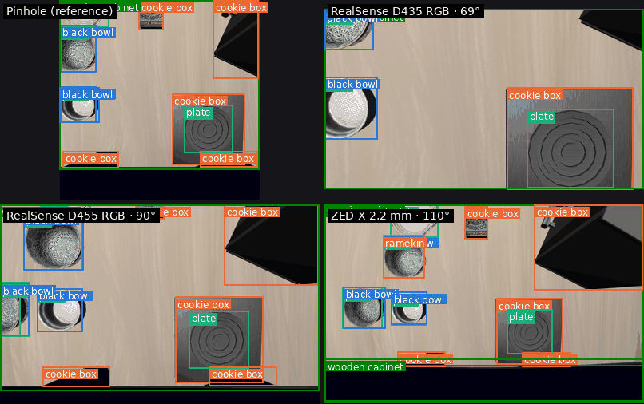
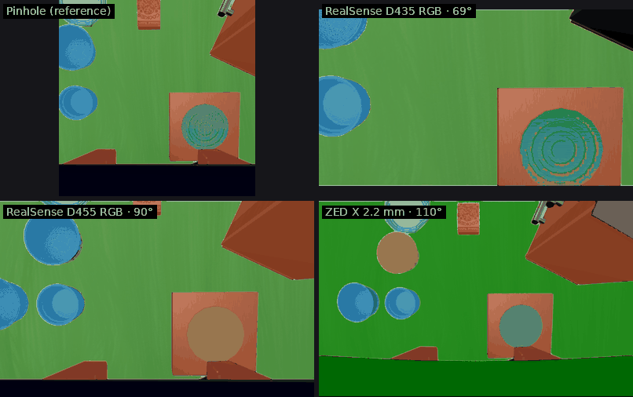
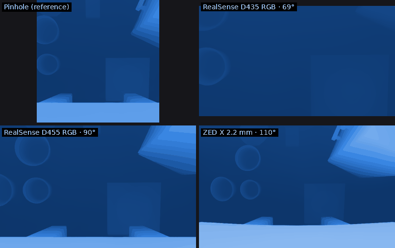

# Camera benchmark

**Which camera will my robot see best with?** The TwinRobo benchmark puts each catalog
camera's digital twin on a robot, in place of the robot's wrist camera, and scores what it
sees: object detection and segmentation, depth from one image, grounding with a
vision-language model, and how far it reads a fiducial marker.

This is version 0.2, in simulation only: it shows what the twins predict and how the
benchmark works. Whether real cameras rank the same way is the next step (see
[What is next](#what-is-next)). The full numbers are on [Results](results.md).

!!! note "Corrected"
    The first version measured every camera from LIBERO's third-person (agent-view)
    position, which is not where a robot's camera sits. It was withdrawn; these results come
    from the robot's wrist. The third-person tables remain on the results page, marked
    secondary.

## How it works

- **Cameras on the robot.** Each of the 12 [catalog](../catalog.md) cameras replaces the
  robot's wrist camera (75° vertical in LIBERO), in two conditions:
    - **on the wrist:** the camera's own field of view, resolution, lens and focus;
    - **optics only:** the wrist view's field of view with the camera's sensor and lens,
      which separates the optics from the framing.

    The reference is an ideal pinhole at the wrist.

    
    *One scene from the robot's wrist through three cameras (rows, by horizontal field of
    view), on the wrist and optics only.*

- **Scenes.** 200 fixed LIBERO frames: LIBERO-Spatial demonstrations at three points of
  each episode, and the initial layouts of LIBERO-Object, LIBERO-Goal and LIBERO-10.
  Every image comes with the simulator's depth and object labels, warped through the same
  lens.
- **Tasks.** One model per task, pinned to an exact release, the same for every camera:

| Task | What it measures | Model |
|---|---|---|
| Detection | mAP at IoU 0.5 of the scene's objects | Grounding DINO |
| Segmentation | mask IoU, given each object's true box | SAM |
| Depth | depth error on the objects, from one image | Depth Anything V2 |
| Grounding | "where is the black bowl?": the answer's box lands on it | Qwen2.5-VL-7B |
| Fiducial | range, corners found and pose error of a 21 x 15 cm ChArUco board | none (OpenCV), with the camera's calibration |

- **Reproducible.** Seeds, deterministic GPU kernels, greedy decoding and seeded
  confidence intervals: recomputing a result gives the same numbers, bit for bit. Each
  result records the TwinRobo-Core commit and model revisions it was computed with.

## What the cameras see on the robot

One LIBERO demonstration from the robot's wrist, through the wrist pinhole and three
cameras from narrow to wide, with what the benchmark's models make of every frame.
Mistakes are the models' own (a plate called a cookie box, the gripper called a bowl).

=== "Detection"

    { loading=lazy }

=== "Segmentation"

    { loading=lazy }

=== "Depth"

    { loading=lazy }

    Depth from one image, on one color scale for every camera: light is near (4 cm), dark is
    far (37 cm).

## Findings

### On the wrist, a wider camera finds more objects

Close above the table, a narrow camera cuts objects out of its frame. The widest camera
in the catalog finds the most, the narrowest the least:

The Stereolabs ZED X 2.2 mm (80° vertical) scores 41.2 mAP50 [39.2-44.7]; the Intel
RealSense D435 RGB (42.5°) 33.5 [31.6-38.3]. In between, the order follows the field of
view only loosely, and most intervals overlap.

### ...and a narrower one measures depth better

The same wide lenses cost depth accuracy: their barrel distortion bends what a monocular
depth model expects to be straight.

The D435 RGB's error on the objects is 8.3 % [7.1-9.8], the ZED X 2.2 mm's 12.2 %
[11.0-13.3]. On a robot's wrist, choosing a camera is a trade-off: a wide one to find
things, a narrow one to measure them, or a wide one whose images are undistorted before
the depth model.

### Color matters

The Luxonis OAK-D's mono camera scores lowest on detection (30.3 mAP50). It and the
RealSense infrared eyes (rendered in visible light) are about 10 points lower on grounding
than the color cameras (51.5 and 52.8 % against 57-65 %):

### Focus matters close up

At the wrist, objects are 0.1-0.4 m away; many catalog cameras are focused at about 1 m.
Refocusing the Logitech C920 from 1 m to 0.3 m lowers its depth error from 13.0 % to
11.4 % in the optics-only condition; as mounted the change is within noise (8.6 % and
8.4 %).

### Resolution sets how far a camera reads a marker

The fiducial test uses every pixel (no model resizes the image), so pixel count and field
of view show directly: the 12 MP Raspberry Pi Camera Module 3 finds the board out to
3.1 m, the 1080p cameras to about 2 m, the wide 1-2 MP cameras to about 1 m.

### What does not separate the cameras

Segmentation, given each object's box, scores 92.7-94.3 for every camera. With the field of
view fixed (optics only), detection spans 38.5 to 43.3, mostly within the intervals. The
catalog's lenses are surrogates scaled to each camera's focal length and f-number, so
differences between real lenses are not expected to show yet.

## Limits

- **Simulation only.** Lenses are surrogates; sensor noise, exposure and motion blur are
  not simulated. The results rank digital twins.
- **Models with limits at the wrist.** Depth Pro's metric scale fails at 0.1-0.4 m (errors of
  56-111 % for every camera, the reference included), so it is left out of the wrist results.
  Qwen2.5-VL's boxes are compressed sideways by 2-3 % on some image sizes.
- **Optics-only depth.** The optics-only view keeps the wrist's 75° vertical field at each
  sensor's aspect ratio (about 107° wide for a 16:9 sensor), so its depth column mixes in
  aspect ratio and is not used in the findings.
- **No robot policy yet.** A policy evaluated with its wrist camera swapped is planned.

## What is next

1. **Real captures:** the fiducial and detection tests with the real cameras on a robot
   arm, compared with their twins' ranking.
2. **Measured lenses** for a few cameras (the [calibration tool](../calibration.md)) and
   the sensor noise model, so lens and low-light differences can show.
3. **A robot policy** run with each camera on its wrist.

The benchmark's code will be released with the real-capture study.
